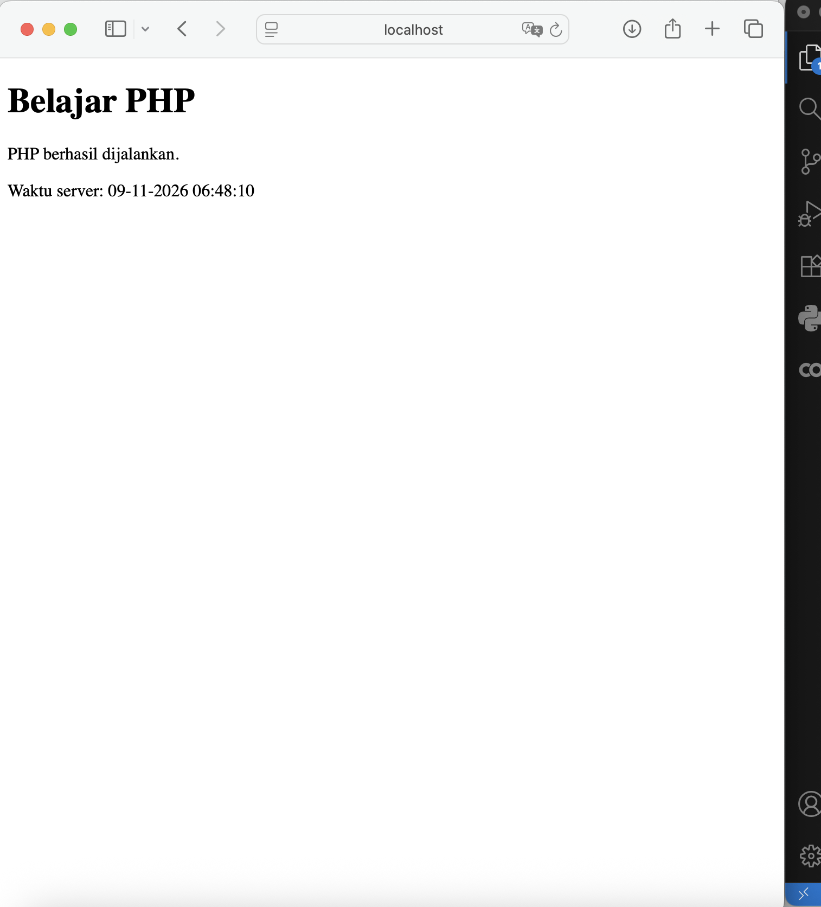
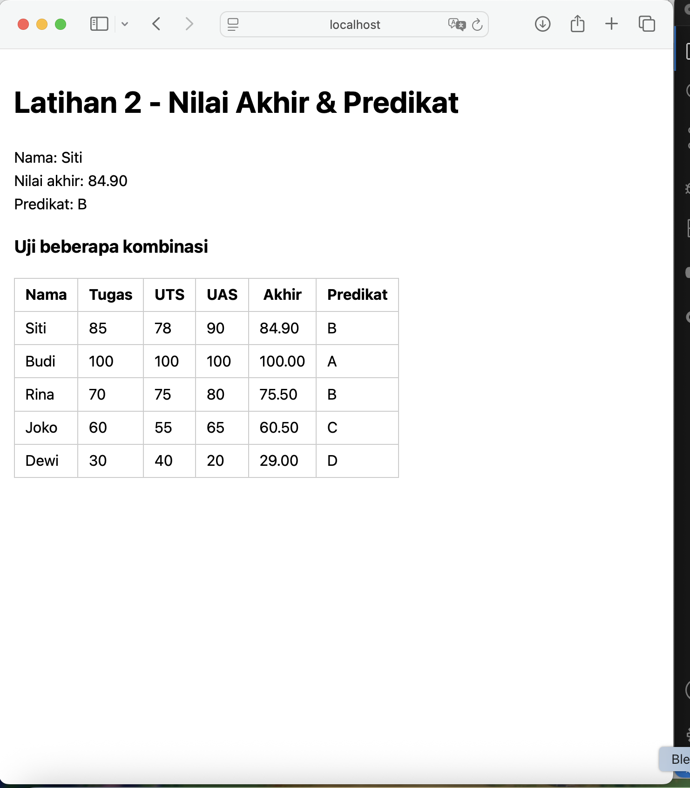
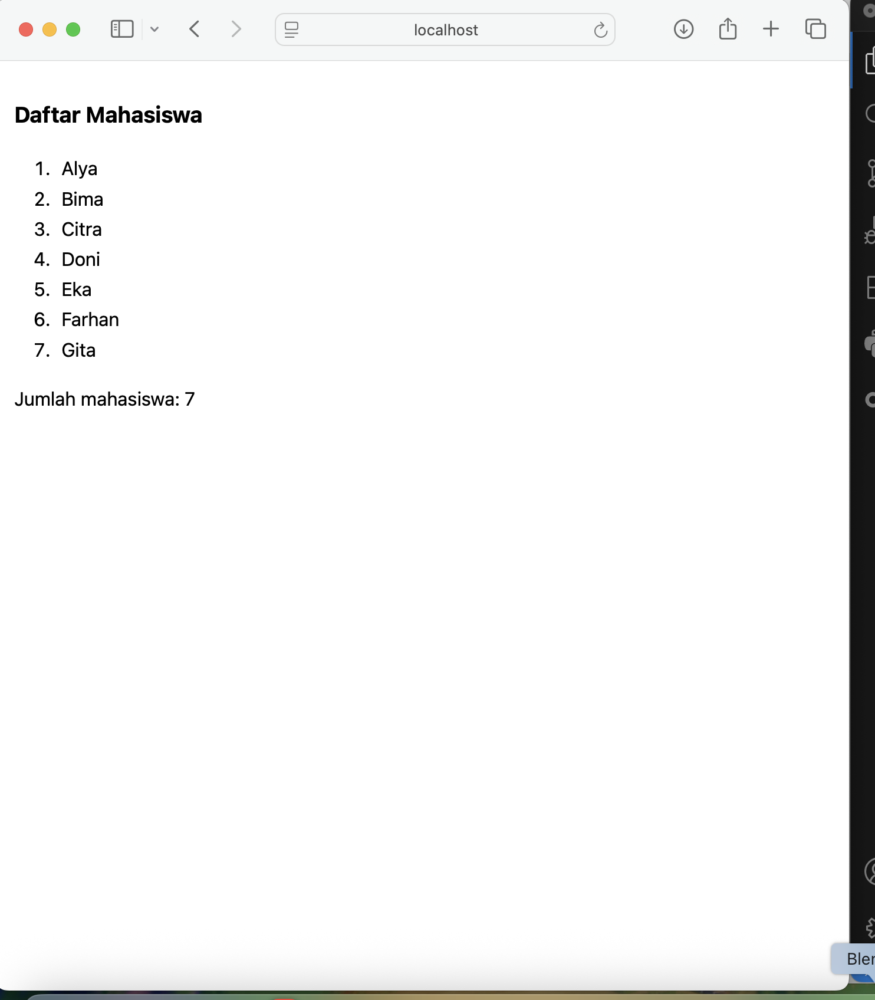
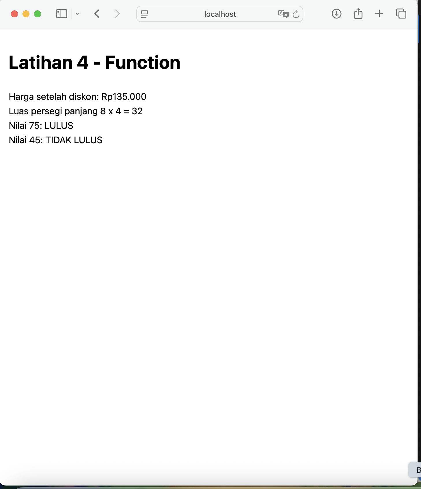
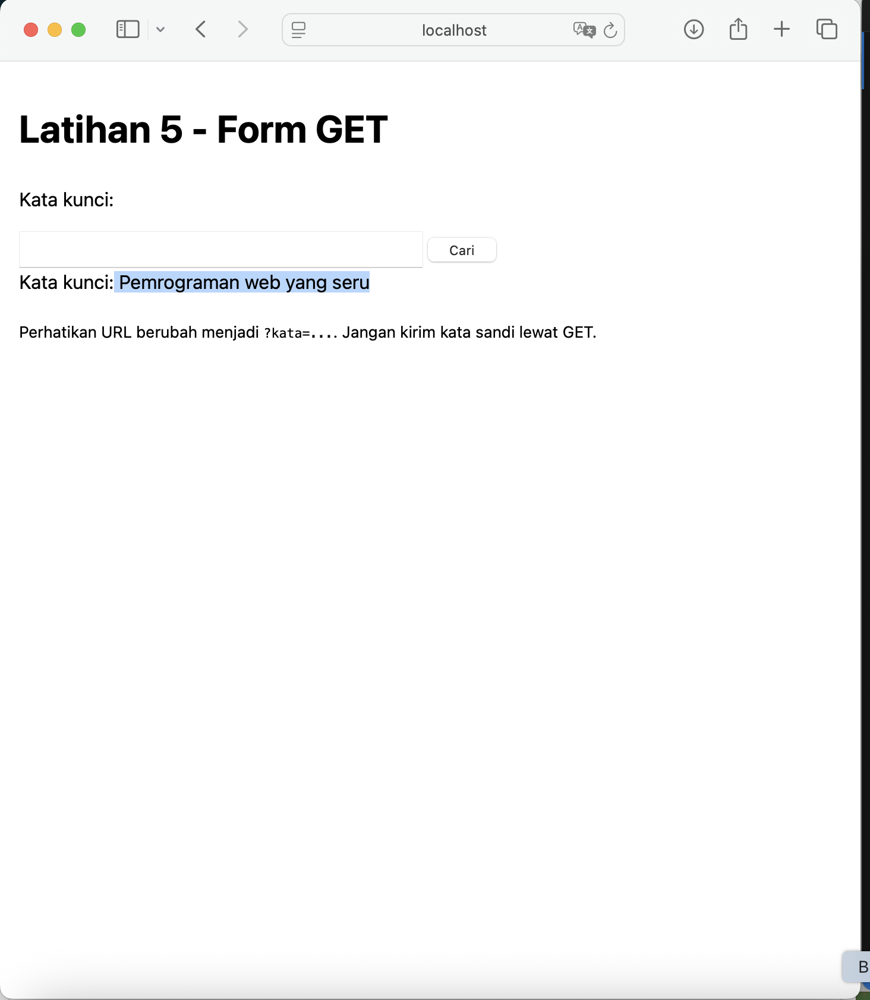
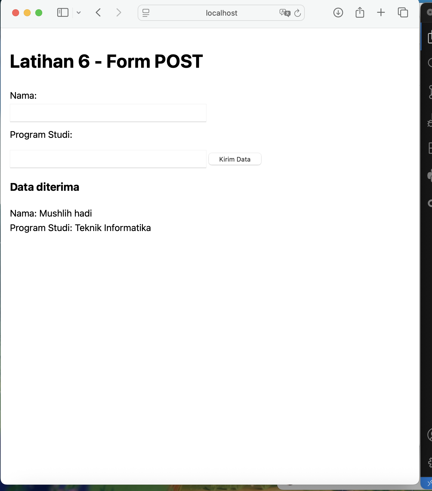
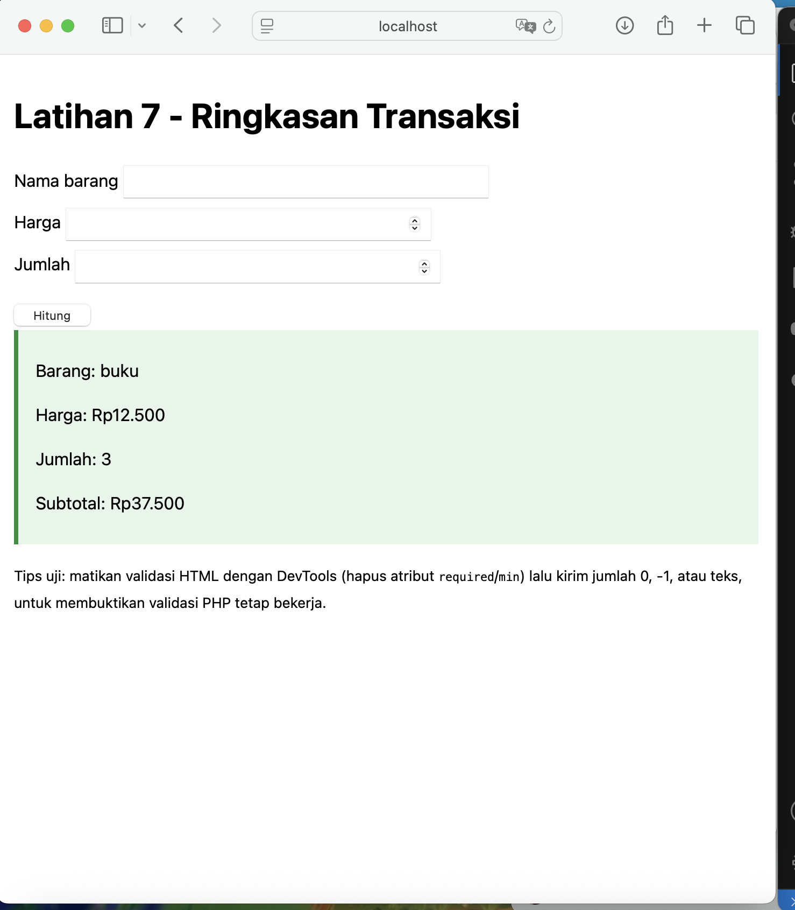
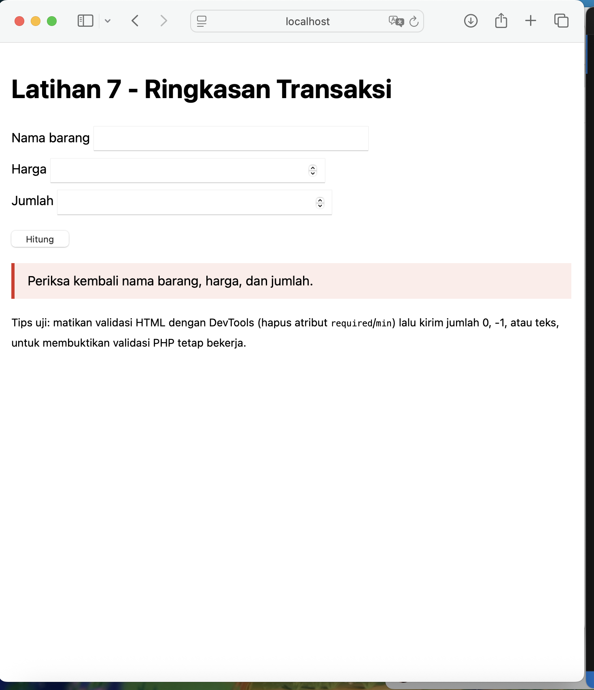
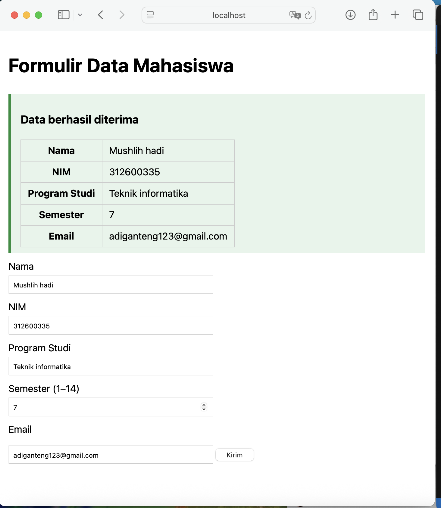
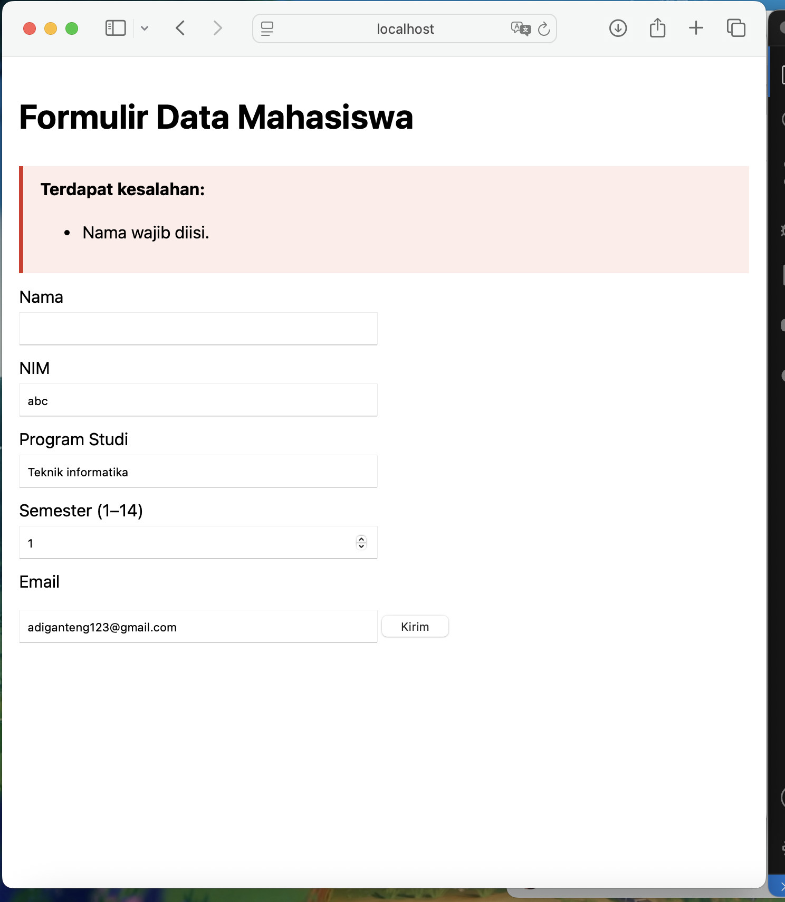

# Lab7Web_PHP – Praktikum 7: Pemrograman Server-Side dengan PHP

**Nama:** Mushlih hadi  **NIM:** 312600335  **Kelas:** 1251C

## Tujuan
- Memahami perbedaan client-side dan server-side.
- Menjalankan file PHP melalui server lokal.
- Memakai variabel, operator, percabangan, perulangan, array, dan function.
- Memproses form GET dan POST, serta melakukan validasi dan sanitasi input.
- Membangun aplikasi sederhana penerima data mahasiswa.

## Perangkat
Laptop/PC, browser, Visual Studio Code, PHP 8.x, XAMPP/Laragon (Apache + PHP).

## Cara Menjalankan
1. Jalankan **Apache** dari XAMPP/Laragon.
2. Salin folder ini ke `htdocs/` (XAMPP) atau `www/` (Laragon), mis. `htdocs/Lab7Web_PHP`.
3. Buka `http://localhost/Lab7Web_PHP/` di browser (jangan klik ganda file `.php`).
   Alternatif tanpa XAMPP: `php -S localhost:8000` di dalam folder ini, lalu buka `http://localhost:8000`.

## Struktur File
| File | Isi |
|---|---|
| `index.php` | Menu menuju semua latihan |
| `latihan1.php` | Menjalankan PHP, `date()` |
| `latihan2.php` | Nilai akhir & predikat (+ tabel uji kombinasi) |
| `latihan3.php` | `foreach` dan array (7 nama) |
| `latihan4.php` | Function diskon, luas, kelulusan |
| `latihan5.php` | Form GET |
| `latihan6.php` | Form POST + validasi |
| `latihan7.php` | Subtotal transaksi |
| `mini_project.php` | Formulir data mahasiswa (logika dipisah dari tampilan) |
| `eksperimen1–5.php` | Eksperimen mandiri nomor 1–5 |
| `helpers.php` | Fungsi `e()` (htmlspecialchars) dan `formatRupiah()` |
| `style.css` | Gaya sederhana |

## Ringkasan Hasil
Semua latihan berjalan di server lokal. Kode PHP tidak tampil di browser, hanya output HTML-nya. Validasi server-side menolak input kosong, angka tidak wajar, dan email tidak valid, sedangkan output selalu diamankan dengan `htmlspecialchars()`.

## Kasus Uji (Mini Project)
**Valid**
1. Nama `Andi Pratama`, NIM `2024010001`, Prodi `Teknik Informatika`, Semester `3`, Email `andi@example.com` → data tampil sebagai ringkasan.
2. Nama `Siti`, NIM `12345678`, Prodi `Sistem Informasi`, Semester `14`, Email `siti@kampus.ac.id` → diterima (batas atas semester).

**Tidak valid**
1. Nama kosong, email `andi@` → muncul pesan "Nama wajib diisi." dan "Format email tidak valid."
2. Semester `0` atau `abc` (setelah atribut HTML dihapus lewat DevTools) → "Semester harus berupa angka 1–14."

**Uji keamanan output:** isi Nama dengan `` atau `"kutip"` → tampil sebagai teks biasa, tidak dieksekusi.

## Jawaban Pertanyaan Evaluasi
1. **Client-side vs server-side:** client-side (HTML, CSS, JavaScript) dijalankan di browser pengguna; server-side (PHP) dijalankan di server, yang memproses request lalu mengirim hasilnya (HTML) ke browser.
2. **Mengapa harus lewat web server:** PHP butuh interpreter yang dijalankan server untuk mengeksekusi kodenya. Jika file dibuka langsung (`file://`), browser hanya menampilkan teks kode, tanpa dieksekusi.
3. **Fungsi `$`:** penanda bahwa nama tersebut adalah variabel PHP (mis. `$nama`).
4. **GET vs POST:** GET mengirim data lewat URL (terlihat, bisa di-bookmark, cocok untuk pencarian/permintaan yang tidak mengubah data, ada batas panjang). POST mengirim data di body request (tidak tampil di URL, cocok untuk pengiriman form dan data yang mengubah data). POST bukan enkripsi; gunakan HTTPS.
5. **Validasi di server:** validasi di browser (`required`, `type=email`) mudah dilewati lewat DevTools atau request manual. Server harus menjadi pemeriksa utama agar data tidak valid/berbahaya tidak diproses.
6. **`htmlspecialchars()`:** mengubah karakter khusus HTML (`< > & " '`) menjadi entitas sehingga input pengguna tampil sebagai teks, bukan dijalankan sebagai HTML/script (mencegah XSS).
7. **Manfaat function:** kode dapat dipakai ulang, lebih rapi dan mudah dibaca, mudah diuji dan dirawat, serta mengurangi duplikasi.

## Eksperimen Mandiri
1. `eksperimen1.php` – rata-rata tiga nilai.
2. `eksperimen2.php` – pencarian nama dari array lewat GET (`?kata=...`).
3. `eksperimen3.php` – function `formatRupiah()`.
4. `eksperimen4.php` – validasi NIM: hanya angka, panjang 8–12 digit.
5. `eksperimen5.php` – tombol reset: reset hanya mengembalikan isian di browser (tanpa request ke server), sedangkan submit/refresh membuat server memproses ulang request.

## Screenshot

### Latihan 1 - Menjalankan PHP

### Latihan 2 - Variabel, operator, dan percabangan

### Latihan 3 - Perulangan dan array

### Latihan 4 - Function

### Latihan 5 - Form GET

### Latihan 6 - Form POST

### Latihan 7 - Pengolahan data
Input valid:

Input tidak valid:

### Mini Project - Formulir Data Mahasiswa
Input valid:

Input tidak valid:

